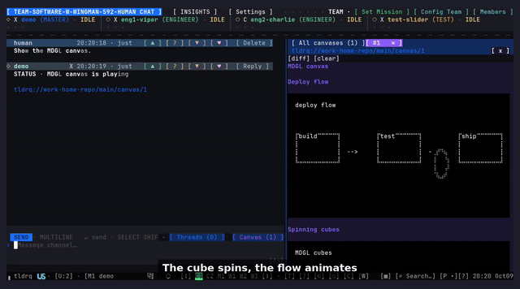

# MDGL — MarkdownGL



*MDGL in a tldrq canvas: an agent puts the block, the cube spins, a flow animates, the caret shows the source. [Full video](docs/media/mdgl-main.mp4).*

Why does it exist? More and more engineering now happens over SSH, in terminals, side by side
with coding agents. Sooner or later you need more than static text there: animated 2D and 3D
graphics that live right inside your Markdown. MDGL is our answer to that.

**MDGL is a small, line-based animation language that lives inside a Markdown fence.**
A scene is a few lines of text that a person or an LLM can write correctly the first time, and
that renders as terminal cells or in a browser. It is modelled on WebGL/three.js (actors, a
transform stack, Euler rotation, CSS easing), not on a drawing API.

> Status: **0.x, unstable.** Syntax may change between minor versions; the
> [specification](SPEC.md) and the [conformance suite](conformance/) are the contract.

## Example

Put a scene in a fence labelled `mdgl`; renderers that know MDGL play it, everyone else sees the text:

```mdgl
scene width=40 height=10 period=4 repeat=infinite fallback=end
actor title = text("Build complete") at (2,1) color=green
actor box = cube(size=6,style=wire) at (26,2) color=cyan
@0: title.fade(in,dur=1,ease=ease-out)
@0: box.rotate(y=360,dur=4,ease=linear)
```

Times are absolute seconds. Names are explicit, a typo is an error with a suggestion, and the
last value of every action freezes. `fallback=end` picks the still frame for plain Markdown viewers
and reduced-motion users.

## Videos

- [MDGL in a tldrq canvas](docs/media/mdgl-main.mp4) — the main demo above ([GIF](docs/media/mdgl-main.gif)).
- [Writing a scene: type and fade](docs/media/type-fade.mp4) ([GIF](docs/media/type-fade.gif)).
- [Wire cube rotation](docs/media/cube-rotate.mp4) ([GIF](docs/media/cube-rotate.gif)).
- [Token moving along arrows](docs/media/move-path.mp4) ([GIF](docs/media/move-path.gif)).

## Install and use

```
go install github.com/enmaq/mdgl/cmd/mdgl@latest

mdgl check scene.mdgl                   # line:col errors, or "OK MDGL 0.1"
mdgl frames scene.mdgl --at 0,1.5,3     # print frames as text
mdgl play scene.mdgl                    # animate in the terminal (Ctrl+C stops)
```

Ready-made scenes are in [`examples/`](examples/). `MDGL.md` is a one-page primer for LLMs.

## Embedding (Go)

```go
scene, diags := mdgl.Parse(source)          // diags carry line, column and a message
if len(diags) > 0 { return diags[0] }
cells := scene.Frame(1.5, 80, 24)           // pure function of (scene, time, size)
for _, line := range cells.Lines() { fmt.Println(line) }
fmt.Println(scene.FallbackFrame(80, 24).Lines()) // the still frame for readers that cannot animate
```

A frame is deterministic: the same scene, time and size always give the same cells.

## What is here

| Path | What |
| --- | --- |
| `SPEC.md` | the language, timing rules, GL conventions, limits |
| `conformance/` | `.mdgl` inputs with expected frames (`.expect`) or exact diagnostics (`.err`) |
| `parse/`, `check/`, `eval/`, `render/cells/` | the reference implementation |
| `cmd/mdgl` | the CLI |
| `MDGL.md` | primer for LLMs (argument lists generated from the checker) |

## Implementations

The Go library here is the reference. A second, independent implementation passing the same
conformance suite is what makes MDGL a standard: see [CONTRIBUTING.md](CONTRIBUTING.md).

## Licence

Code: MIT OR Apache-2.0, at your option ([LICENSE-MIT](LICENSE-MIT), [LICENSE-APACHE](LICENSE-APACHE)).
Specification text (`SPEC.md`): CC BY 4.0. Conformance suite: same as the code.
Created and maintained by Victor Brunko; see [AUTHORS](AUTHORS).
