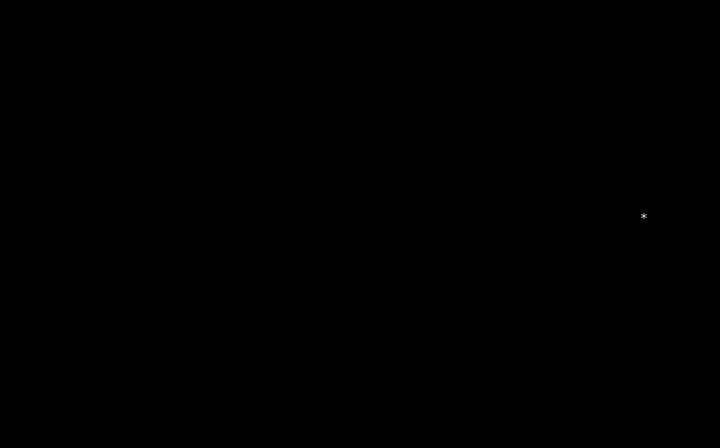
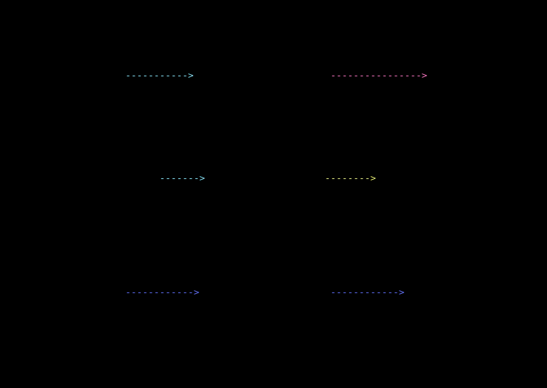

# MDGL — MarkdownGL



*A neon cube intro, rendered as animated terminal braille cells. [Full video](docs/media/neon-cube.mp4).*

Why does it exist? More and more engineering now happens over SSH, in terminals, side by side
with coding agents. Sooner or later you need more than static text there: animated 2D and 3D
graphics that live right inside your Markdown. MDGL is our answer to that.

**MDGL is a small, line-based animation language that lives inside a Markdown fence.**
A scene is a few lines of text that a person or an LLM can write correctly the first time, and
that renders as terminal cells (a terminal-cell renderer is available in all five languages; a browser/WebGL renderer is planned, not available). It is modelled on WebGL/three.js (actors, a
transform stack, Euler rotation, CSS easing), not on a drawing API.

> Status: **0.x, unstable.** Syntax may change between minor versions; the
> [specification](SPEC.md) and the [conformance suite](conformance/) are the contract.

## Example

Put a scene in a fence labelled `mdgl`; renderers that know MDGL play it, everyone else sees the text:

```mdgl
scene width=40 height=10 period=4 repeat=infinite fallback=end
actor title = text("Build complete") at (2,1) color=green
actor box = cube(size=6,style=wire) at (26,2) color=cyan
@0: title.fade(in,dur=1,ease=ease-out)
@0: box.rotate(y=360,dur=4,ease=linear)
```

Times are absolute seconds. Names are explicit, a typo is an error with a suggestion, and the
last value of every action freezes. `fallback=end` picks the still frame for plain Markdown viewers
and reduced-motion users.

## Videos

- [Neon cube intro](docs/media/neon-cube.mp4) ([GIF](docs/media/neon-cube.gif)) — the lead demo above.
- [Kubernetes: from desired state to a running service](docs/media/kubernetes.mp4) ([GIF](docs/media/kubernetes.gif)).
- [LLM inference: tokens to the next-token loop](docs/media/llm.mp4) ([GIF](docs/media/llm.gif)).

## Install and use

This is MDGL 0.3.1 for all five languages; see [Language support](#language-support) for the exact install commands.
The CLI shown here is the Go one:

```
go install github.com/enmaq/mdgl/go/cmd/mdgl@v0.3.1

# Historical: the old root-module CLI (v0.1.1) predates the move and is superseded:
# go install github.com/enmaq/mdgl/cmd/mdgl@v0.1.1

mdgl check scene.mdgl                   # line:col errors, or "OK MDGL 0.1"
mdgl frames scene.mdgl --at 0,1.5,3     # print frames as text
mdgl play scene.mdgl                    # animate in the terminal (Ctrl+C stops)
```

Ready-made scenes are in [`examples/`](examples/). `MDGL.md` is a one-page primer for LLMs.

### Play the three showcase demos

From a checkout (Python 3 and Go on `PATH`, and a UTF-8 terminal):

```sh
cd v/mdgl && python3 scripts/example-media.py              # or: python3 <checkout>/v/mdgl/scripts/example-media.py
python3 scripts/example-media.py play examples/llm.mdgl --loops 1   # one scene
```

It plays `neon-cube`, `kubernetes` and `llm` once each (every scene is finite here, about 77 seconds in all (measured)), in ANSI
colour with Unicode braille. Ctrl+C stops it and restores the terminal. When stdout is redirected, or `NO_COLOR` or
`MDGL_REDUCED_MOTION` is non-empty, it prints each scene's plain fallback frame once with no escape sequences. `--loops N` repeats
each scene; `--forever` is the only unbounded mode. Use a terminal of at least 100 columns by 35 rows (110x40 recommended): the
widest scenes are 96 columns (`kubernetes`, `llm`), the tallest 34 rows (`kubernetes`) plus a title line. A smaller terminal is
unsupported (no clipping or resize handling). `play` uses only the Go adapter (comparison across all five languages and the GIF/MP4
export are the `verify` and `export` subcommands below). Diagnostics go to stderr.

#### Verify and export the demos (all five adapters)

```sh
python3 scripts/example-media.py verify                      # build, check, compare; writes only the manifest
python3 scripts/example-media.py export [SCENE.mdgl ...] [--out DIR] [--formats gif,mp4]   # verify, then GIF/MP4 + manifest
python3 scripts/example-media.py export --out docs/media --formats gif    # how the repository assets are produced
```

The default scenes are the three above and the default `--out` is a new temp directory that is printed. Both commands copy the
sources (`go rust c ts python conformance examples`, no build outputs) to an isolated temp stage and build all five adapters
there (Go, Rust release, C via CMake, TypeScript via `npm ci` then `npm run build`, Python in place), so the repository is never
written and no preexisting `node_modules`, `dist` or `target` is needed. Required tools: `go`, `cargo`+`rustc`, `cmake`+`cc`,
`node`+`npm` (`npm ci` needs the registry or a warm npm cache; likewise the Go and Cargo module downloads), `python3`; `export` also
needs Pillow, `ffmpeg` (with libx264 for MP4) and `/usr/share/fonts/truetype/dejavu/DejaVuSansMono.ttf` (package `fonts-dejavu-core`).

What is compared: `check` on each scene through each adapter, then every frame at integer `time_ns = round(k*1e9/fps)` across one
period (explicit period) or the finite duration, plus the exact end frame once for finite scenes (the same sampling as `play`:
an infinite scene never requests a time at or past its period). Every adapter is asked for the frame in turn and the answers are
compared immediately, so only one frame is held at a time. The comparison is exact: every cell's rune, fg and bg, the frame size
and `done`; there is no trimming or normalisation. The `fallback:true` frame is compared separately. The first difference stops
that scene and prints the scene, `time_ns`, frame index, row, column, both adapters and both cells; a JSON failure report is
written (`--failure-report`, default a temp dir) and the exit code is 1. Other exit codes: 2 usage, 3 required tool unavailable,
4 build failed, 5 protocol or transport failure (or a malformed response), 6 invalid scene, 7 raster/encode failure.

Only after every scene agrees across all five adapters are the frames rasterised (Pillow, DejaVu Sans Mono, 8x16 px cells, the
`play` colour palette, black where the background is empty, braille drawn procedurally from its U+2800 dot mask, 2x4 dots per cell) and encoded with ffmpeg
(`-fflags +bitexact -map_metadata -1 -an`, GIF with `palettegen` and no dithering, MP4 with libx264 `crf 23`, one thread).
The media use every `ceil(fps/10)`-th agreed frame (at most 10 frames per second; the comparison itself covers every frame) and
a finite scene's last frame is held for 1 s. A failing run publishes no media: files are copied to `--out` only at the very end.

`example-media-manifest.json` is written next to the media. It holds, per scene, the relative path and sha256, the frame counts,
the sha256 of every frame's canonical cell grid (cells and `done`) and of the whole sequence, the fallback frame hash, the
adapter commands with placeholder paths, the tool versions, the font file name and sha256, the raster metrics and the ffmpeg
flags, and the media files' sha256. It has no timestamps and no absolute paths. Honest limits: the frame and sequence hashes are
the deterministic evidence; encoded GIF/MP4 bytes are only reproducible with the same ffmpeg and font versions and no byte
identity across encoders or fonts is claimed. The comparison shows the five adapters agree on these three scenes; it does not
prove the output matches SPEC. CI (`example-media-e2e` in `.github/workflows/ci.yml`) runs the same `export` command and
uploads the media, manifest and any failure report as workflow artifacts; it never commits.

Previews:   

## Embedding (Go)

```go
scene, diags := mdgl.Parse(source)          // diags carry line, column and a message
if len(diags) > 0 { return diags[0] }
cells := scene.Frame(1.5, 80, 24)           // pure function of (scene, time, size)
for _, line := range cells.Lines() { fmt.Println(line) }
fmt.Println(scene.FallbackFrame(80, 24).Lines()) // the still frame for readers that cannot animate
```

A frame is deterministic: the same scene, time and size always give the same cells.

## What is here

| Path | What |
| --- | --- |
| `SPEC.md` | the language, timing rules, GL conventions, limits |
| `conformance/` | `.mdgl` inputs with expected frames (`.expect`) or exact diagnostics (`.err`) |
| `go/parse/`, `go/check/`, `go/eval/`, `go/render/cells/` | the reference implementation |
| `go/cmd/mdgl` | the CLI |
| `MDGL.md` | primer for LLMs (argument lists generated from the checker) |

## Implementations

The Go library here is the reference. A second, independent implementation passing the same
conformance suite is what makes MDGL a standard: see [CONTRIBUTING.md](CONTRIBUTING.md), the
[adopter guide](docs/ADOPTER-GUIDE.md), the [adoption roadmap](docs/ADOPTION-ROADMAP.md) and the project draft
[RFC 0001](rfcs/0001-mdgl-interoperability-and-registration-roadmap.md) (not an IETF document; no media type is registered).

## Licence

Code: MIT OR Apache-2.0, at your option ([LICENSE-MIT](LICENSE-MIT), [LICENSE-APACHE](LICENSE-APACHE)).
Specification text (`SPEC.md`): CC BY 4.0. Conformance suite: same as the code.
Created and maintained by Victor Brunko; see [AUTHORS](AUTHORS).

## Language support

| | Go | Rust | C | JS/TS (npm `@enmaq/mdgl`) | Python |
| --- | --- | --- | --- | --- | --- |
| Full parser, checker, evaluator, renderer | YES | YES | YES | YES | YES |
| Conformance adapter ([`conformance/`](conformance/)) | YES | YES | YES | YES | YES |
| Terminal player (`mdgl play FILE`) | YES | YES | YES | YES | YES |
| Runnable example | `go run ./examples/render` (in `go/`) | `cargo run --example render` (in `rust/`) | in `c/`: `cmake -S . -B build && cmake --build build --target mdgl_render`, then `./build/mdgl_render` | `ts/examples/render.mjs` ([`ts` README](ts/README.md#examples)) | `python examples/render.py` (in `python/`) |
| Install 0.3.1 | `go install github.com/enmaq/mdgl/go/cmd/mdgl@v0.3.1` | `cargo install mdgl --version 0.3.1 --locked` | source build, no registry: `cmake -S c -B c/build && cmake --build c/build` (see [`c/README.md`](c/README.md)) | `npm install @enmaq/mdgl@0.3.1` (or `npx -p @enmaq/mdgl@0.3.1 mdgl play scene.mdgl`) | `pip install mdgl==0.3.1`, then `mdgl play FILE` |

JavaScript is the compiled TypeScript in the same npm package, not an independent implementation. Library use: Go imports
`github.com/enmaq/mdgl/go` (`go get github.com/enmaq/mdgl/go@v0.3.1`); Rust `cargo add mdgl@0.3.1`; JS/TS `require('@enmaq/mdgl')`.

Provenance (0.3.0): in 0.3.0 the public git tags `v0.3.0` and `go/v0.3.0` retain the original source tree, while the registry packages carry corrected
version-neutral metadata and README text (see [CHANGELOG.md](CHANGELOG.md)); code, API and version are unchanged.

**Terminal player.** Animation is verified on Unix/POSIX only. Per-language limits, as each language README documents: C is POSIX only for
animation (Windows prints the plain frame; Windows/MSVC build untested, see [`c/README.md`](c/README.md)); TypeScript/JS needs an ANSI terminal at least as
wide and tall as the scene (see [`ts` README](ts/README.md#terminal-player-mdgl-play-file)); Rust: Unix only is verified, Windows Ctrl+C untested. When stdout is not a terminal, or `MDGL_REDUCED_MOTION` or `NO_COLOR` is non-empty, it prints the
plain fallback frame once, with no escapes or timers. Ctrl+C exits 130 for Rust, C, JS/TS and Python, and 0 for Go.

**Evidence.** The 86-fixture corpus (64 normative + 22 non-normative/profile-assumption) passed on all five adapters under the bounded
protocol-v1 profile in an independent verification on 2026-10-10 UTC (accepted by the coordinator). Dated history: the earlier
final-integration result (2026-10-10 UTC) was 83 fixtures (63 normative + 20 non-normative), before the 3 `obs_circle_*` fixtures were added;
those were then matched by all five adapters in a targeted run. The 64 normative fixtures are derived from SPEC; the 22 non-normative fixtures rest on documented profile assumptions and provenance ([`conformance/REFERENCE_PROFILE.md`](conformance/REFERENCE_PROFILE.md), [`conformance/PROTOCOL.md`](conformance/PROTOCOL.md)). This is bounded evidence, not a
universal SPEC certification, and no full-conformance claim is made for any implementation. Open spec gaps (G-numbers) and profile assumptions
are listed in [`conformance/README.md`](conformance/README.md). C note: the library builds with `_GNU_SOURCE` and its locale-dependent test is
skipped when `de_DE.UTF-8` is not installed.

At 0.x only the latest minor is supported and nothing is promised stable before 1.0; supported builds are the ones in CI.
The package version (`VERSION`, 0.3.1) is not the grammar version: the `mdgl 0.1` header is defined by [SPEC.md](SPEC.md) and does not change
with `VERSION`. See [RELEASING.md](RELEASING.md).

### Adapters

Each language folder contains a parser, a checker, an evaluator and a terminal-cell renderer (as stated by that folder's README), plus an adapter for the
[observable conformance protocol v1](conformance/PROTOCOL.md).

| Language | Adapter command (build first; run from the `v/mdgl` checkout, paths absolute for the runner) | Own tests that read the shared fixtures |
| --- | --- | --- |
| Go | `cd go && go build -o <out>/mdgl-conformance ./cmd/conformance`, then `<out>/mdgl-conformance` | `go/conformance_test.go` (legacy fixtures); `go/cmd/conformance/main_test.go` is transport only |
| Rust | `cargo build --release --manifest-path rust/Cargo.toml --bin mdgl-adapter`, then `rust/target/release/mdgl-adapter` | `rust/tests/conformance.rs`, `rust/tests/frames.rs` (legacy and observable fixtures), `rust/tests/adapter.rs` |
| C | `cmake -S c -B c/build && cmake --build c/build`, then `c/build/mdgl_adapter` | `c/test_adapter.py` (transport); `c/test_render.c` derives from SPEC and protocol examples |
| TypeScript / JS | `npm --prefix ts run build`, then `node ts/bin/mdgl-adapter.js` | `ts/test/corpus.test.js`, `ts/test/expect.test.js`; `ts/test/adapter.test.js` |
| Python | `env PYTHONPATH=<checkout>/python python3 -m mdgl.adapter` | `python/tests/test_parse_check.py`, `python/tests/test_render.py` (legacy fixtures); `python/tests/test_adapter.py` |

Run the shared runner against any adapter:

```
python3 scripts/conformance-runner.py --adapter '<cmd>'
```

The fixture inventory (86 fixtures: 64 normative, 22 non-normative) and known open gaps are in
[`conformance/README.md`](conformance/README.md).
